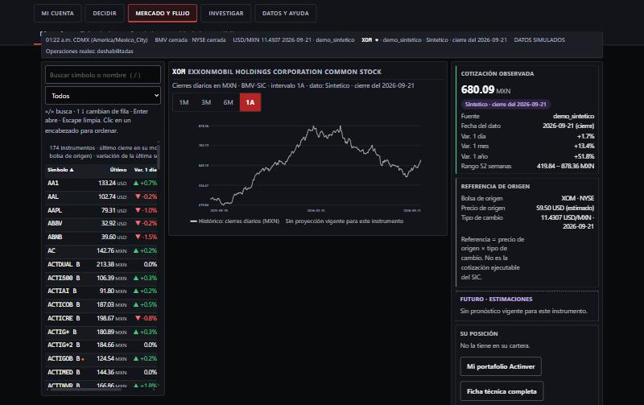
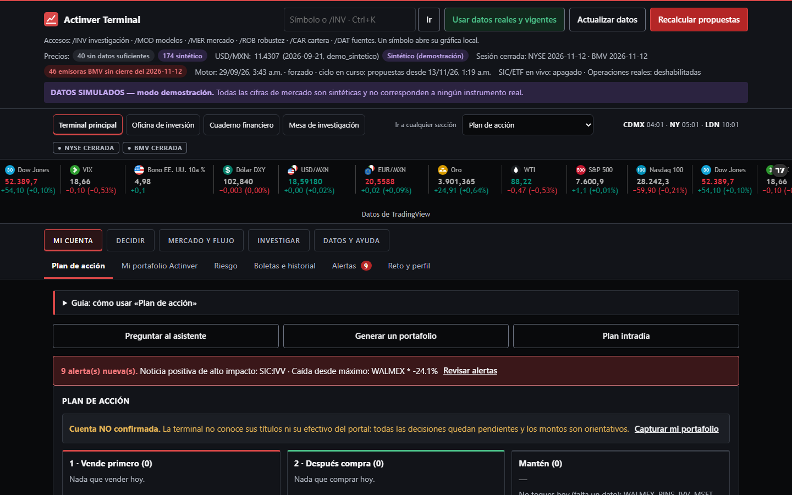
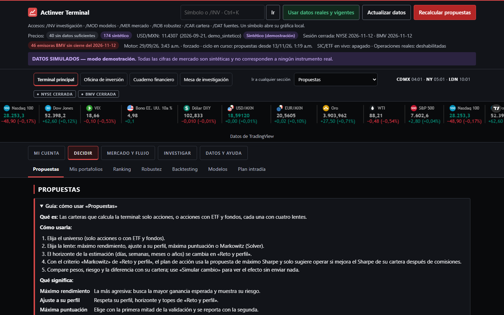
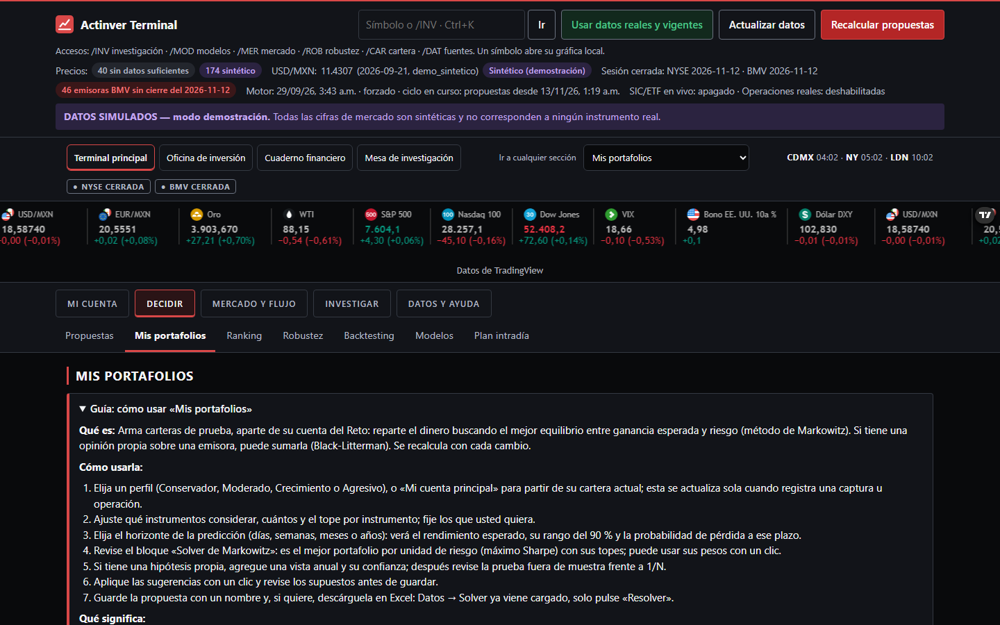
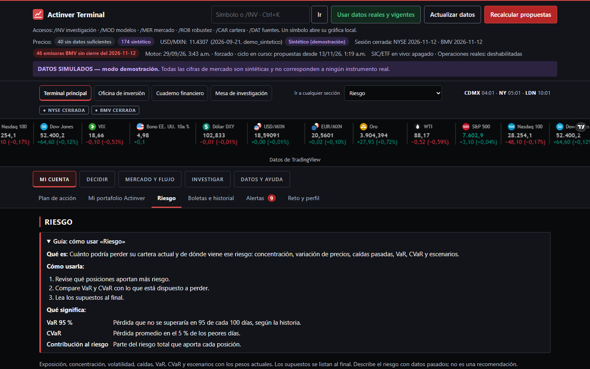
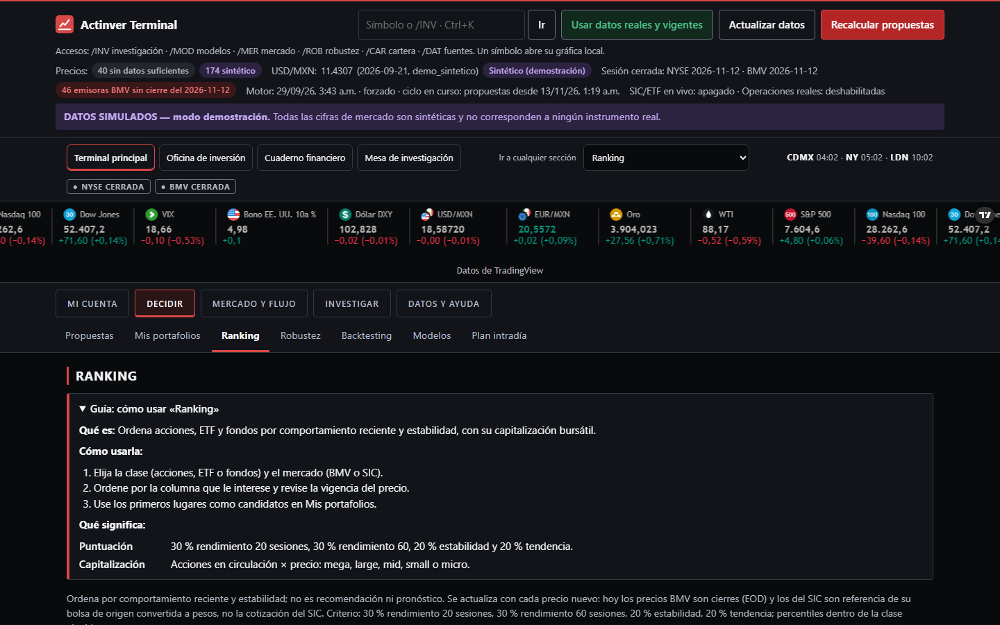

# Help Quote Terminal · Actinver Terminal

Terminal local de análisis de portafolios: compara propuestas de inversión contra la cartera real, mide el riesgo, optimiza con Markowitz y muestra una estación de mercado. Nació para el **Reto Actinver 2026** y sigue como herramienta de largo plazo e intradía. Declara su incertidumbre en lugar de prometer certeza.

**Solo informa y simula.** Ninguna ruta envía órdenes a una casa de bolsa ni al simulador del Reto.

**Sitio (demo pública):** https://maikolv.github.io/help-quote-terminal/ · **Correr desde GitHub:** [](https://codespaces.new/Maikolv/help-quote-terminal?quickstart=1)





## Qué hace

| Bloque | Resultado |
|---|---|
| Plan del día | Vende / compra / mantén con cantidad, precio límite, motivo y condición que lo invalida; el mismo texto por Telegram (`/plan`) |
| Propuestas | «Solo acciones» y «Acciones + ETF + fondos», con lentes de máximo rendimiento, perfil y Markowitz (Solver); validación fuera de muestra frente a 1/N |
| Mis portafolios | Perfiles Conservador → Agresivo, Ledoit-Wolf, máximo Sharpe, topes en USD y por sector, Black-Litterman y Excel con Solver precargado |
| Riesgo | VaR/CVaR, contribución por emisora, modos de venta estricto/suave y reglas validadas en 1,600 carteras (2022 → sep-2026) |
| Estación de Mercado | Monitor ordenable, gráfico con proyección 10–90 %, inspector, teclado (`/`, ↑↓, Enter) y vista de celular |
| Flujo | Velas con indicadores, Order Flow (footprint, TPO, POC/VAH/VAL) y Option Flow (Heston, GEX) |
| Laboratorio | Permutación, Holm, preregistro y holdout único; TSM mensual y anomalías de volumen |
| Datos y fuentes | Fuente, moneda, retraso y vigencia de cada dato; un precio vencido nunca se presenta como vigente |
| Alertas | Telegram y escritorio: pérdida del día, cambios entre capturas y avisos por emisora |

| Propuestas | Mis portafolios |
|---|---|
|  |  |
| **Riesgo** | **Ranking** |
|  |  |

Las capturas usan **datos simulados** (modo demostración).

## Cómo correr

### En su PC (Windows)

Requisito: [uv](https://docs.astral.sh/uv/) (`winget install astral-sh.uv`).

```bat
start.bat            :: datos reales
start.bat demo       :: datos sintéticos etiquetados, base separada en data/demo/
```

Equivalentes: `uv run terminal iniciar` / `uv run terminal demo`. Se abre `http://127.0.0.1:8765`.

### Desde GitHub (Codespaces)

**Code → Codespaces → Create codespace on main** (o el botón de arriba). Cuando termine `uv sync`:

```bash
uv run terminal demo --sin-navegador      # demostración
uv run terminal actualizar && uv run terminal iniciar --sin-navegador   # datos reales con su .env
```

El puerto 8765 queda privado a su cuenta. Guía, seguridad y costo (gratis dentro de la cuota personal): [docs/codespaces.md](docs/codespaces.md).

### En el navegador, sin instalar

- [Demo pública en GitHub Pages](https://maikolv.github.io/help-quote-terminal/): estación de Mercado con datos simulados.
- Artifact de Claude (privado del autor): foto de la estación con cierres reales.

Los datos reales no se publican en Pages: las licencias gratuitas de los proveedores no permiten redistribuirlos.

## Datos reales

Copie `.env.example` como `.env` y complete las claves que tenga. Sin ninguna clave ya funcionan el tipo de cambio (FRED), el calendario macro y los titulares. Las propuestas quedan **suspendidas** hasta tener precios: la terminal no simula cotizaciones.

| Fuente | Uso | Credencial |
|---|---|---|
| FRED · Banxico SIE | USD/MXN, CETES 28, bonos | No · `BANXICO_TOKEN` gratuito |
| Tiingo · Alpaca (solo datos) | Cierres de EE. UU. y precio IEX en vivo del SIC/ETF | Claves gratuitas |
| EODHD | Cierres de la BMV | `EODHD_API_KEY` (20/día gratis) |
| SEC EDGAR | Formulario 4, 13F y sectores SIC | `SEC_USER_AGENT` |
| ForexFactory · Seeking Alpha RSS | Calendario macro y titulares | No |
| CSV propio | NAV de fondos, precios, operaciones, universo | No |

Solo proveedores gratuitos: los conectores de pago están bloqueados (`app.solo_proveedores_gratuitos=true`). Matriz completa en [docs/proveedores-gratuitos.md](docs/proveedores-gratuitos.md).

## Comandos

| Comando | Qué hace |
|---|---|
| `uv run terminal iniciar` | Servidor local + motor automático (proceso aparte de prioridad baja) |
| `uv run terminal demo` | Igual, con datos sintéticos |
| `uv run terminal actualizar` | Descarga incremental respetando límites por proveedor |
| `uv run terminal reporte cierre` | Reporte en Markdown (`preapertura`, `cierre`, `semanal`) |
| `uv run terminal investigar` | Experimento walk-forward → validación → prueba |
| `uv run terminal respaldar` | Respaldo verificado (se conservan 5) |
| `uv run terminal telegram` | Configura el chat de Telegram y envía una prueba |

## Cómo probar

```bash
uv run pytest -q                      # ≈ 950 pruebas de Python
node --test tests/*.test.mjs          # 52 pruebas de la interfaz
npm --prefix cloud-alerts test        # 19 pruebas del Worker
uv run python scripts/escanear_secretos.py
```

En cada push a `main`, GitHub Actions corre las pruebas de Python y del Worker sin secretos, y publica `sitio/` en GitHub Pages.

## Estructura

```
terminal/        servidor FastAPI, motor, propuestas, riesgo, Markowitz, flujo, investigación
web/             interfaz HTML/CSS/JS sin build (index.html, app.js, estacion.js, app.css)
config/          ajustes, reglas del Reto, sectores y capitalización
sitio/           portada y estación demo para GitHub Pages
cloud-alerts/    Worker de Cloudflare (aviso de terminal apagada)
tests/           pytest y node:test
docs/            diseño, auditorías, metodología, decisiones y capturas
.devcontainer/   Codespaces
```

## Documentación

| Documento | Contenido |
|---|---|
| [Resumen ejecutivo](docs/resumen-ejecutivo.md) | Qué es, estado y decisiones pendientes |
| [Arquitectura](docs/initial-audit.md) · [DESIGN.md](DESIGN.md) | Flujo de datos y sistema visual |
| [Metodología cuantitativa](docs/quant-methodology.md) · [Model card](docs/model-card.md) | Resultados fuera de muestra |
| [Reglas del Reto](docs/actinver-rules.md) | Fragmento oficial y prueba que cubre cada regla |
| [Validación de riesgo](docs/mejora-fable-20261110.md) | Reglas de venta frente a mantener |
| [Decisiones](docs/decisiones.md) · [Seguridad](docs/seguridad.md) | Registro D-01… y checklist con evidencia |
| [CHANGELOG](CHANGELOG.md) | Historial de cambios |

## Seguridad

- Escucha solo en `127.0.0.1`; acepta además el dominio exacto de su propio Codespace o de su Tailscale autorizado.
- CSP estricta, token CSRF y Origin local en toda mutación.
- Secretos solo en `.env` (ignorado por Git); escaneo de secretos en el historial.
- La cuenta del Reto se captura a mano desde el portal: la terminal no inicia sesión ni lo automatiza.

## Aviso

Herramienta de análisis personal. No es asesoría de inversión; los rendimientos esperados son estimaciones inciertas con datos históricos y **ningún modelo tiene ventaja demostrada**. Verifique costos y reglas con su casa de bolsa.
